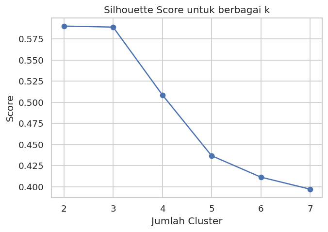
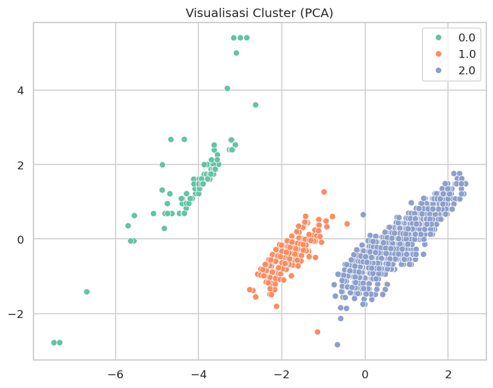
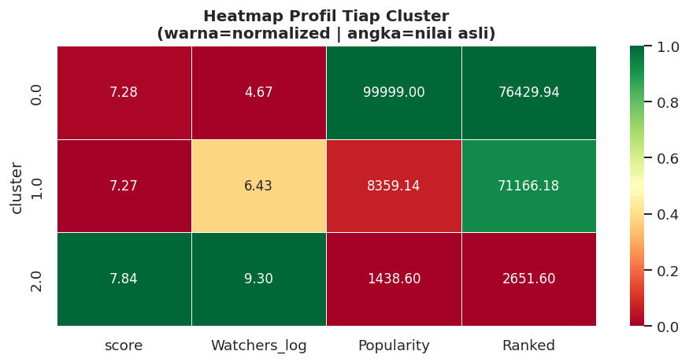
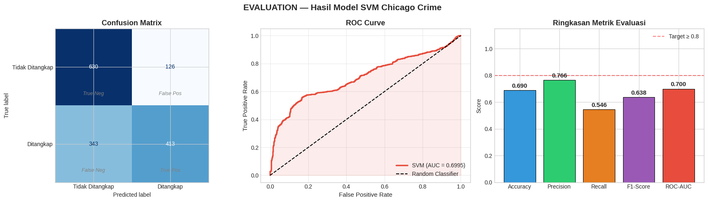
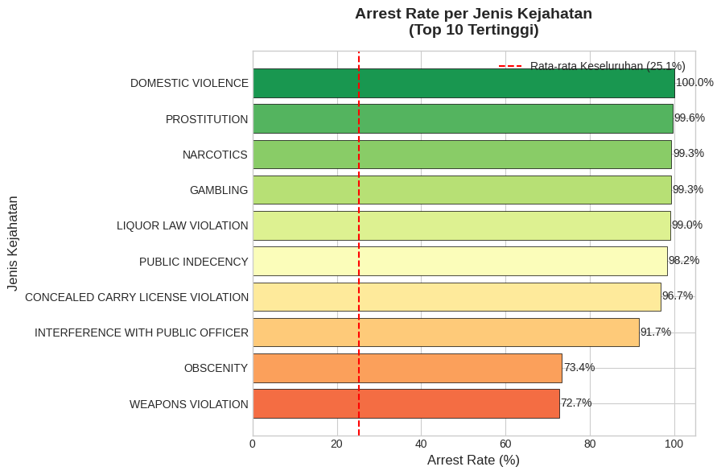
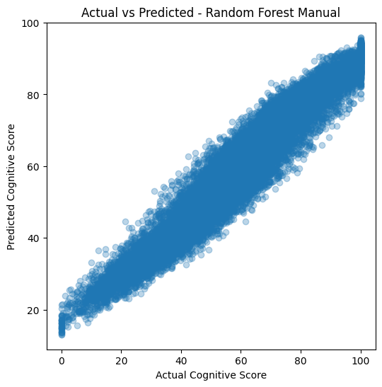
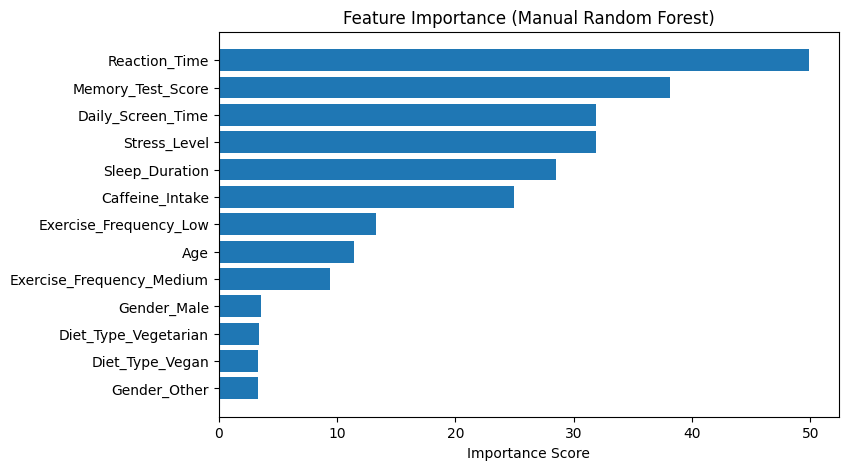
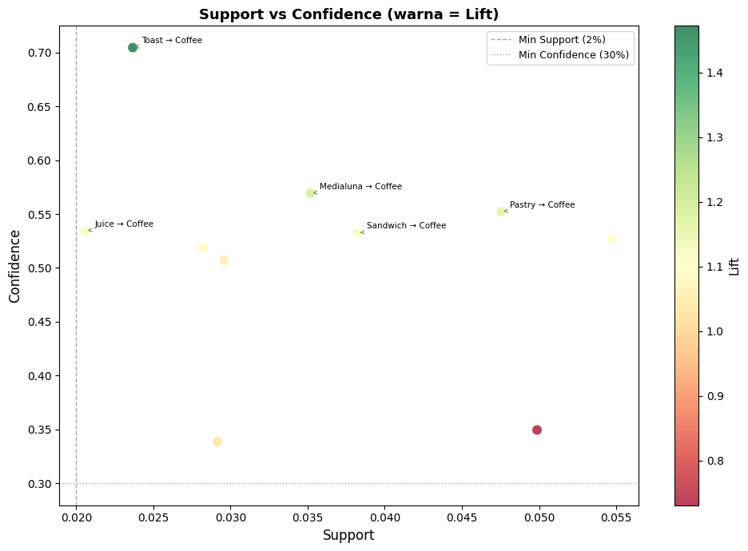
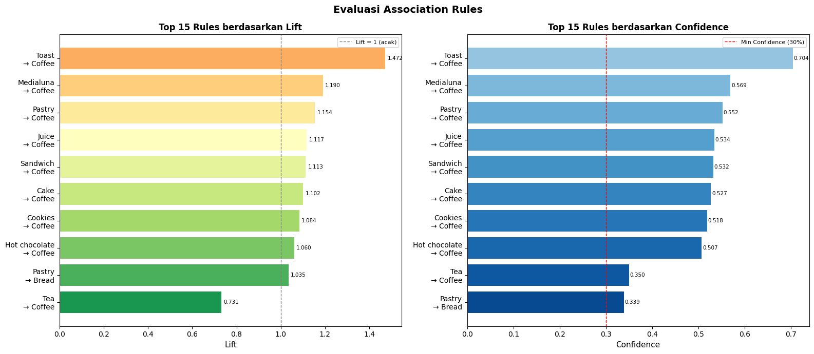

# Data Science dengan Pendekatan CRISP-DM: Clustering, Classification, Regression, dan Association Rule Mining

Kumpulan empat studi kasus data science pada dataset Kaggle yang berbeda. Setiap studi kasus mengikuti alur CRISP-DM (Business Understanding, Data Understanding, Data Preparation, Modeling, Evaluation, Deployment), menggunakan Python.

| Metode | Algoritma | Dataset | Hasil Utama |
| ----- | ----- | ----- | ----- |
| Clustering | K-Medoids | Korean Drama List | 3 klaster, Silhouette Score 0,5889 |
| Classification | SVM (RBF) | Chicago Crime | Accuracy 0,6898, ROC-AUC 0,6995 |
| Regression | Random Forest Regressor (from scratch) | Human Cognitive Performance | R² 0,9065, RMSE 7,0198 |
| Association | ECLAT (from scratch) | Bakery Transactions | 33 frequent itemset, 10 rules, lift maks. 1,4724 |

Random Forest Regressor dan ECLAT diimplementasikan dari nol tanpa library modeling (hanya NumPy dan pandas).

## Struktur Repositori

```
├── notebooks/
│   ├── 01_clustering_kmedoids_kdrama.ipynb
│   ├── 02_classification_svm_chicago_crime.ipynb
│   ├── 03_regression_random_forest_cognitive.ipynb
│   └── 04_association_eclat_bakery.ipynb
├── assets/            
├── data/
│   └── README.md      
├── requirements.txt
└── README.md
```

## 1. Clustering: K-Medoids pada Dataset Drama Korea

**Tujuan.** Mengelompokkan drama Korea berdasarkan popularitas dan performa untuk mendukung segmentasi dan rekomendasi pada platform streaming.

**Data dan persiapan.** Fitur yang dipakai: `score`, `Watchers`, `Popularity`, `Ranked`. Kolom `Watchers` dibersihkan dari karakter koma, ditransformasi `log(1 + x)` karena distribusinya sangat miring ke kanan, lalu seluruh fitur distandarisasi dengan `StandardScaler`.

**Pemodelan.** Jumlah klaster dipilih dengan Silhouette Score untuk k = 2 sampai 7. Model akhir menggunakan K-Medoids dari `pyclustering` dengan k = 3.

**Hasil.** Silhouette Score model akhir 0,5889 (medium structure).

| Klaster | score | Watchers (log) | Popularity | Ranked |
| ----- | ----- | ----- | ----- | ----- |
| 0 | 7,28 | 4,67 | 99999 | 76.430 |
| 1 | 7,27 | 6,43 | 8.359 | 71.166 |
| 2 | 7,84 | 9,30 | 1.439 | 2.652 |

Klaster 2 berisi drama populer dengan skor tertinggi. Klaster 1 berisi drama dengan popularitas menengah. Klaster 0 berisi drama dengan jumlah penonton rendah dan nilai `Popularity` 99999.

| Silhouette per k | Visualisasi PCA | Profil klaster |
| ----- | ----- | ----- |
|  |  |  |

## 2. Classification: SVM pada Dataset Chicago Crime

**Tujuan.** Memprediksi apakah suatu kasus kejahatan berujung pada penangkapan (`Arrest`).

**Data dan persiapan.** Dataset berisi 8.500.901 baris dan 22 kolom, dengan 25,15% kasus berujung penangkapan. Lima fitur dipilih berdasarkan Cramér's V (kategorikal) dan Point Biserial Correlation (numerik). Langkah persiapan:

- Ekstraksi jam (`Hour`) dari kolom tanggal.
- 15.673 baris bermasalah (0,18%) dihapus.
- Label Encoding untuk fitur kategorikal.
- Sampling acak 15.000 baris karena kompleksitas SVM.
- Undersampling kelas mayoritas hingga seimbang (7.558 baris, 50:50).
- Split 80:20 stratified (6.046 latih, 1.512 uji).

**Pemodelan.** Pipeline `StandardScaler` dan `SVC`, dengan GridSearchCV 5-fold pada 36 kombinasi (C, kernel, gamma). Parameter terbaik: C = 1, kernel = RBF, gamma = 0,1.

**Hasil pada data uji.**

| Accuracy | Precision | Recall | F1-Score | ROC-AUC |
| ----- | ----- | ----- | ----- | ----- |
| 0,6898 | 0,7662 | 0,5463 | 0,6378 | 0,6995 |





**Keterbatasan.** Model dilatih pada sampel kecil dari data asli, dan recall kelas "Ditangkap" masih rendah. Pengembangan berikutnya: SMOTE atau class weighting, serta target atau frequency encoding untuk fitur kategorikal.

## 3. Regression: Random Forest Regressor pada Dataset Human Cognitive Performance

**Tujuan.** Memprediksi `Cognitive_Score` dari faktor gaya hidup dan kondisi individu.

**Data dan persiapan.** Dataset berisi 80.000 baris tanpa missing value dan tanpa duplikat. Kolom `User_ID` (identifier) dan `AI_Predicted_Score` (data leakage) dihapus. Fitur kategorikal di-encode dengan One-Hot Encoding (`drop_first=True`), menghasilkan 13 fitur. Split 80:20 (64.000 latih, 16.000 uji) dan standarisasi dilakukan manual, dengan statistik skala dihitung hanya dari data latih.

**Pemodelan.** Decision Tree dan Random Forest Regressor diimplementasikan dari nol. Hyperparameter dicari dengan grid search manual.

**Hasil pada data uji.**

| RMSE | MAE | R² |
| ----- | ----- | ----- |
| 7,0198 | 5,6961 | 0,9065 |

Model menjelaskan sekitar 90,65% variasi `Cognitive_Score`. Berdasarkan frekuensi fitur sebagai titik split, fitur paling berpengaruh adalah `Reaction_Time` dan `Memory_Test_Score`, diikuti `Daily_Screen_Time`, `Stress_Level`, `Sleep_Duration`, dan `Caffeine_Intake`.

| Actual vs Predicted | Feature Importance |
| ----- | ----- |
|  |  |

## 4. Association Rule Mining: ECLAT pada Dataset Bakery

**Tujuan.** Menemukan pola item yang sering dibeli bersamaan untuk cross-selling, bundling, dan penataan produk.

**Data dan persiapan.** 20.507 baris, 9.465 transaksi unik, 94 item unik (11 Januari 2016 sampai 3 Desember 2017). Sebanyak 1.620 baris duplikat dihapus karena analisis berbasis binary basket, lalu data diubah ke format basket dan vertical TID-set.

**Pemodelan.** ECLAT dari nol dengan interseksi TID-set secara rekursif, minimum support 2% dan minimum confidence 30%. Setiap rule dihitung support, confidence, lift, dan conviction.

**Hasil.** 33 frequent itemset dan 10 association rules, 9 di antaranya dengan lift > 1.

| Rule | Confidence | Lift |
| ----- | ----- | ----- |
| Toast → Coffee | 70,44% | 1,4724 |
| Medialuna → Coffee | 56,9% | 1,190 |
| Pastry → Coffee | 55,2% | 1,154 |
| Tea → Coffee | 35,0% | 0,731 |

Coffee menjadi item sentral transaksi. Rule Tea → Coffee memiliki lift di bawah 1, artinya kedua item justru cenderung tidak dibeli bersamaan.

| Support vs Confidence | Top Rules |
| ----- | ----- |
|  |  |

## Dataset

Dataset tidak disertakan di repositori. Unduh dari Kaggle:

- [Korean Drama List](https://www.kaggle.com/datasets/iphigeniebera/korean-drama-list-about-740-unique-dramas)
- [Chicago Crime Dataset 2024-2026](https://www.kaggle.com/datasets/aliafzal9323/chicago-crime-dataset-2024-2026)
- [Human Cognitive Performance Analysis](https://www.kaggle.com/datasets/samxsam/human-cognitive-performance-analysis)
- [Bakery Transactions](https://www.kaggle.com/datasets/akashdeepkuila/bakery)

## Cara Menjalankan

Notebook ditulis dan dijalankan di Kaggle (path data `/kaggle/input/...`). Library yang digunakan: pandas, NumPy, SciPy, scikit-learn, pyclustering, Matplotlib, Seaborn. Untuk menjalankan secara lokal, instal library tersebut, unduh dataset, lalu ubah path pada sel pembacaan data.

## Teknologi

Python, pandas, NumPy, scikit-learn, SciPy, pyclustering, Matplotlib, Seaborn.